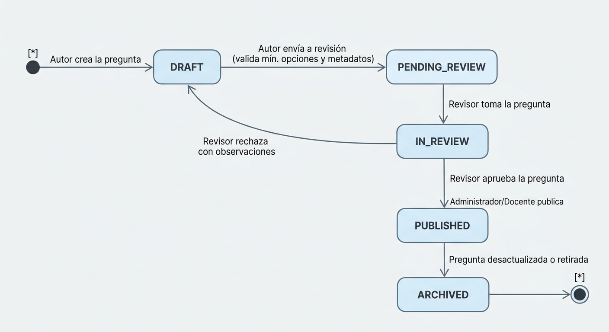
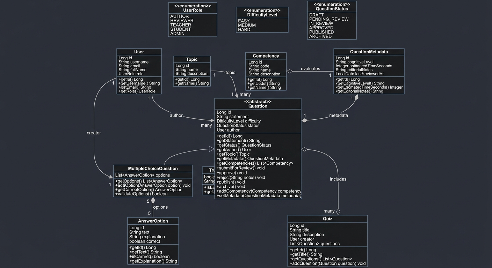
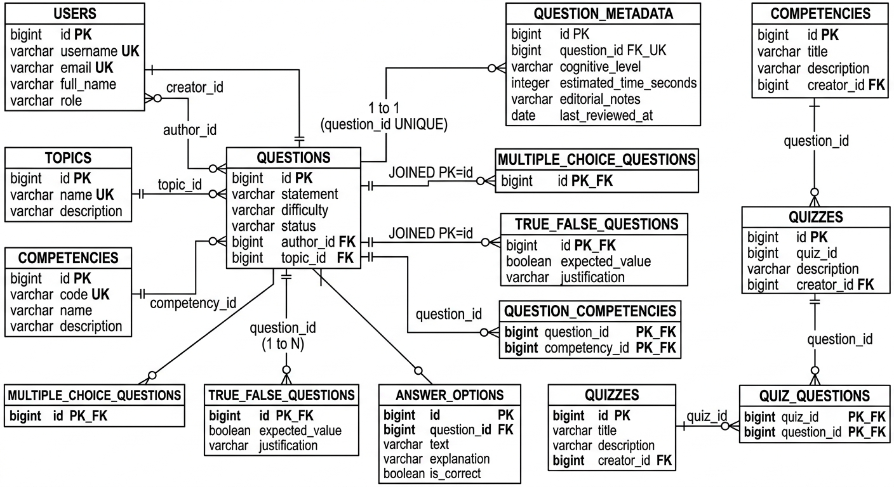

# Documento de Diseño: Banco de Preguntas Saber Pro
**Laboratorio de Ingeniería de Software II — Periodo 2-2026**  
**Taller 10: Java Persistence API - JPA**  
**Universidad del Cauca**
**Duvan Alexis Hoyos y Juan José Hurtado**

---

## 1. Análisis del Dominio del Problema (Punto 2)

El sistema **Banco de Preguntas Saber Pro** es una plataforma orientada a la creación, revisión técnica y pedagógica, clasificación, publicación y conformación de cuestionarios/simulacros de evaluación para las pruebas de Estado Saber Pro.

### 1.1 Actores del Sistema
| Actor | Responsabilidad Principal |
|---|---|
| **Author (Autor)** | Crea y edita preguntas en estado de borrador (`DRAFT`), define su enunciado, opciones de respuesta, tema y competencias asociadas, y las postula a revisión (`PENDING_REVIEW`). |
| **Reviewer (Revisor)** | Evalúa la pertinencia académica, dificultad y claridad de las preguntas postuladas (`IN_REVIEW`). Puede aprobarlas (`APPROVED`) o rechazarlas para que regresen al autor a corrección (`DRAFT`). |
| **Teacher (Docente)** | Diseña y conforma cuestionarios y simulacros (`Quiz`), seleccionando exclusivamente preguntas que ya hayan sido aprobadas y publicadas (`PUBLISHED`). |
| **Student (Estudiante)** | Presenta cuestionarios y simulacros disponibles y consulta sus resultados. |
| **Administrator (Administrador)** | Gestiona usuarios, roles, parámetros del sistema y publica preguntas aprobadas (`PUBLISHED`) o archiva preguntas obsoletas (`ARCHIVED`). |

### 1.2 Ciclo de Vida de las Preguntas (State Machine)
El ciclo de vida de una pregunta está estrictamente controlado por reglas de negocio, garantizando que un cuestionario jamás incorpore preguntas no validadas:




#### Reglas de Invariantes del Ciclo de Vida:
1. Una pregunta en estado `DRAFT` puede ser editada libremente por su autor.
2. Para pasar a `PENDING_REVIEW`, la pregunta debe tener:
   - Enunciado no vacío.
   - Al menos una competencia asociada.
   - Tema (`Topic`) asignado.
   - Metadatos complementarios registrados (`QuestionMetadata`).
   - Si es de selección múltiple: exactamente 5 opciones (4 distractores + 1 respuesta correcta).
   - Si es de verdadero/falso: valor de verdad esperado definido.
3. Solo las preguntas en estado `PUBLISHED` pueden ser vinculadas a un cuestionario (`Quiz`).

---

## 2. Alcance y Selección de Entidades del Dominio

De acuerdo con las sugerencias de la guía (Página 4) y los 5 casos de uso obligatorios (Punto 8), se define el siguiente alcance justificado de entidades:

1. **`User` (con `UserRole`)**: Modela los usuarios del sistema (autores, revisores, administradores, docentes, estudiantes).
2. **`Topic` y `Competency`**: Clasificación académica. `Topic` representa el tema específico (ej. "Arquitectura de Software") y `Competency` la habilidad evaluada (ej. "Diseño de Soluciones").
3. **Jerarquía de `Question`**:
   - `Question` (clase base abstracta): atributos comunes (`id`, `statement`, `difficulty`, `status`, `author`, `topic`, `competencies`, `metadata`).
   - `MultipleChoiceQuestion`: especialización que agrega la lista de `AnswerOption` y valida la respuesta correcta.
   - `TrueFalseQuestion`: especialización que agrega el atributo `expectedValue` (`boolean`).
4. **`QuestionMetadata`**: Metadatos editoriales y psicométricos (nivel cognitivo, tiempo estimado de respuesta en segundos, fecha de última revisión, comentarios de revisión).
5. **`AnswerOption`**: Opciones de respuesta para preguntas de selección múltiple (texto de la opción, justificación/explicación, indicador booleano `isCorrect`).
6. **`Quiz`**: Representa el cuestionario o simulacro de evaluación configurado por un docente, el cual agrega una colección de preguntas en estado `PUBLISHED`.

---

## 3. Diagrama de Clases UML del Dominio (Punto 3)

El siguiente diagrama representa el **modelo conceptual de dominio puro** en Java (sin anotaciones de frameworks ni imports de JPA):



---

## 4. Diseño y Mapeo de las Cuatro Relaciones Obligatorias (Punto 4)

### 4.1 Relación Uno a Uno (`@OneToOne`): `Question` $\leftrightarrow$ `QuestionMetadata`
* **Caso de Negocio:** Toda pregunta tiene asignado exactamente un registro de metadatos complementarios (nivel cognitivo según taxonomía de Bloom, tiempo estimado de respuesta en segundos, notas editoriales y fecha de última revisión).
* **Decisiones de Diseño:**
  1. **Lado Propietario:** `QuestionMetadataRecord`. Posee la anotación `@OneToOne` y la columna de clave foránea `question_id`.
  2. **Ubicación de la Clave Foránea:** Columna `question_id` en la tabla `question_metadata`.
  3. **Garantía de Unicidad (1 a 1 estricto):** La columna `question_id` posee una restricción de índice único (`@Column(unique = true, nullable = false)`), imposibilitando a nivel relacional que una pregunta tenga múltiples registros de metadatos.
  4. **Obligatoriedad y Ciclo de Vida:** La relación es obligatoria para preguntas postuladas a revisión. En `QuestionRecord` se define `mappedBy = "question"`, con `cascade = CascadeType.ALL` y `orphanRemoval = true`, garantizando que si una pregunta se elimina, sus metadatos se eliminen automáticamente.

### 4.2 Relación Uno a Muchos (`@OneToMany`): `Question` $\leftrightarrow$ `AnswerOption`
* **Caso de Negocio:** Una pregunta de selección múltiple (`MultipleChoiceQuestion`) contiene un conjunto de opciones de respuesta (distractores y clave correcta). Cada opción pertenece exclusivamente a una pregunta.
* **Decisiones de Diseño:**
  1. **Lado Propietario:** `AnswerOptionRecord`. Posee `@ManyToOne(optional = false)` y `@JoinColumn(name = "question_id", nullable = false)`.
  2. **Lado Inverso:** En `MultipleChoiceQuestionRecord` se mapea con:
     ```java
     @OneToMany(mappedBy = "question", cascade = CascadeType.ALL, orphanRemoval = true)
     private List<AnswerOptionRecord> options = new ArrayList<>();
     ```
  3. **Prevención de Opciones Huérfanas:** `nullable = false` en la clave foránea impide la existencia de opciones sin pregunta asociada. Al eliminar una pregunta, `orphanRemoval = true` y `CascadeType.ALL` eliminan físicamente todas sus opciones asociadas.
  4. **Control de Regla de Negocio (4 Distractores + 1 Correcta):** 
     - La validación se ejecuta en el **Dominio** antes de persistir o cambiar de estado: la entidad `MultipleChoiceQuestion` verifica que existan exactamente 5 opciones en total y que exactamente una tenga `isCorrect() == true`.

### 4.3 Relación Muchos a Uno (`@ManyToOne`): `Question` $\rightarrow$ `User` y `Question` $\rightarrow$ `Topic`
* **Caso de Negocio:** Múltiples preguntas son elaboradas por un mismo autor (`User`), y múltiples preguntas pertenecen a una misma área temática (`Topic`).
* **Decisiones de Diseño:**
  1. **Lado Propietario:** `QuestionRecord`.
  2. **Claves Foráneas:** Columnas `author_id` y `topic_id` en la tabla base `questions`.
  3. **Integridad Relacional:** Se definen `@JoinColumn(name = "author_id", nullable = false)` y `@JoinColumn(name = "topic_id", nullable = false)`.
  4. **Reglas contra autores inexistentes:** A nivel de base de datos, la FK genera una restricción de clave foránea hacia la tabla `users(id)`. A nivel de servicio de aplicación (`QuestionService`), se valida previamente la existencia del usuario y su rol (`UserRole.AUTHOR`).

### 4.4 Relación Muchos a Muchos (`@ManyToMany`): `Question` $\leftrightarrow$ `Competency`
* **Caso de Negocio:** Una pregunta puede evaluar varias competencias (ej. "Razonamiento Cuantitativo" y "Formulación de Hipótesis"), y una misma competencia es evaluada por cientos de preguntas del banco.
* **Decisiones de Diseño:**
  1. **Nombre de la Tabla Intermedia:** `question_competencies`.
  2. **Claves Foráneas:**
     - `question_id` (referencia a `questions.id`).
     - `competency_id` (referencia a `competencies.id`).
  3. **Clave Primaria:** Clave primaria compuesta `PRIMARY KEY (question_id, competency_id)`.
  4. **Lado Propietario:** `QuestionRecord` define:
     ```java
     @ManyToMany
     @JoinTable(
         name = "question_competencies",
         joinColumns = @JoinColumn(name = "question_id"),
         inverseJoinColumns = @JoinColumn(name = "competency_id")
     )
     private Set<CompetencyRecord> competencies = new HashSet<>();
     ```
  5. **Análisis del Reto de Diseño (Atributo de Peso / Porcentaje de Contribución):**
     - Si la relación es no ponderada, `@ManyToMany` directo con tabla de unión es la solución más limpia y eficiente.
     - *Justificación para sustentación:* Si el sistema exigiera almacenar el peso porcentual de contribución (ej. 60% competencia A, 40% competencia B), la tabla intermedia se promovería a una entidad asociativa `QuestionCompetency` (`id`, `weightPercentage`, `question`, `competency`), modelada con dos relaciones `@ManyToOne`. Para el alcance base del taller, se implementa `@ManyToMany` directo por claridad y simplicidad técnica, dejando documentada la alternativa asociativa para las preguntas de sustentación.

### 4.5 Relación de Evaluación: `Quiz` $\leftrightarrow$ `Question` (`@ManyToMany`)
* **Caso de Negocio:** Un cuestionario o simulacro (`Quiz`) agrupa múltiples preguntas del banco, y una pregunta puede ser reutilizada en múltiples simulacros.
* **Tabla Intermedia:** `quiz_questions` con `quiz_id` y `question_id`.
* **Regla de Negocio Crítica:** En `QuizService.addQuestion(quizId, questionId)`, se verifica que `question.getStatus() == QuestionStatus.PUBLISHED`. Si la pregunta no está en estado `PUBLISHED`, se rechaza con una excepción de regla de negocio (`IllegalStateException`).

---

## 5. Aplicar Herencia en el Modelo de Preguntas (Punto 5)

### 5.1 Comparación de Estrategias de Herencia en JPA

| Criterio | `SINGLE_TABLE` | `TABLE_PER_CLASS` | `JOINED` (Seleccionada) |
|---|---|---|---|
| **Estructura de Tablas** | 1 tabla única (`questions`) para toda la jerarquía con columna `DTYPE`. | 1 tabla por cada subclase concreta (`mc_questions`, `tf_questions`). No hay tabla base. | 1 tabla base (`questions`) + 1 tabla por cada subclase (`multiple_choice_questions`, `true_false_questions`). |
| **Normalización** | Baja (muchas columnas en `NULL` para tipos ajenos). | Media (duplica columnas de la clase base en cada tabla). | **Alta (3ra Forma Normal estricta).** |
| **Restricciones `NOT NULL`** | No permite `NOT NULL` en atributos de subclases. | Permite `NOT NULL`. | **Permite `NOT NULL` en atributos específicos de cada subclase.** |
| **Consultas Polimórficas (`SELECT q FROM Question q`)** | Muy rápida (sin `JOIN` ni `UNION`). | Lenta (requiere `UNION` de todas las tablas). | **Eficiente (usa `LEFT JOIN` solo sobre las tablas necesarias).** |
| **Integridad Referencial de Asociaciones** | Las relaciones apuntan a la tabla única. | Muy difícil referenciar a `Question` desde FKs externas (ej. `author_id`, `competencies`). | **Excelente: todas las relaciones apuntan limpiamente a `questions.id`.** |

### 5.2 Justificación de la Elección de `InheritanceType.JOINED`
Se selecciona la estrategia **`JOINED`** para el Banco de Preguntas Saber Pro por las siguientes razones de arquitectura de software:
1. **Integridad Relacional y Normalización:** Permite mantener la clave primaria `id` en la tabla base `questions`, de modo que tablas como `question_metadata`, `question_competencies`, y `quiz_questions` establecen sus claves foráneas directamente hacia `questions(id)` sin importar qué tipo de pregunta sea.
2. **Restricciones de Calidad en Subclases:** Permite que columnas exclusivas (como `expected_value` en preguntas de verdadero/falso) tengan restricción `NOT NULL`, lo que no es posible en `SINGLE_TABLE`.
3. **Consistencia Pedagógica:** Respeta y amplía el patrón ya validado en el demo existente con `PersonRecord` $\rightarrow$ `StudentRecord` / `InstructorRecord`.

---

## 6. Diagrama del Esquema Relacional Físico

El diseño físico en la base de datos H2 (`jdbc:h2:mem:questionbankdb`) se estructura de la siguiente manera:



---

## 7. Mapeo a la Arquitectura en Capas Clean Persistence

La solución se organizará en los siguientes paquetes Java dentro del nuevo proyecto:

```text
src/main/java/com/example/questionbank/
├── api/
│   ├── QuestionController.java           (Endpoints REST para preguntas y casos de uso 1, 2, 3, 4)
│   ├── QuizController.java               (Endpoints REST para cuestionarios y caso de uso 5)
│   └── dto/                              (Request/Response DTOs planos)
├── application/
│   ├── QuestionService.java              (Orquestación de casos 1 a 4 con @Transactional)
│   └── QuizService.java                  (Orquestación del caso 5 con validación de estado)
├── domain/
│   ├── model/
│   │   ├── Question.java                 (POJO base)
│   │   ├── MultipleChoiceQuestion.java   (POJO subtipo)
│   │   ├── TrueFalseQuestion.java        (POJO subtipo)
│   │   ├── AnswerOption.java             (POJO)
│   │   ├── QuestionMetadata.java         (POJO)
│   │   ├── QuestionStatus.java           (Enum ciclo de vida)
│   │   ├── DifficultyLevel.java          (Enum)
│   │   ├── User.java                     (POJO)
│   │   ├── UserRole.java                 (Enum)
│   │   ├── Topic.java                    (POJO)
│   │   ├── Competency.java               (POJO)
│   │   └── Quiz.java                     (POJO)
│   └── repository/
│       ├── QuestionRepository.java       (Contrato abstracto independiente de JPA)
│       ├── UserRepository.java           (Contrato abstracto)
│       ├── TopicRepository.java          (Contrato abstracto)
│       ├── CompetencyRepository.java     (Contrato abstracto)
│       └── QuizRepository.java           (Contrato abstracto)
└── infrastructure/
    └── jpa/
        ├── record/
        │   ├── QuestionRecord.java       (Entidad base @Inheritance JOINED)
        │   ├── MultipleChoiceQuestionRecord.java
        │   ├── TrueFalseQuestionRecord.java
        │   ├── QuestionMetadataRecord.java (@OneToOne con @JoinColumn unique=true)
        │   ├── AnswerOptionRecord.java   (@ManyToOne hacia QuestionRecord)
        │   ├── UserRecord.java
        │   ├── TopicRecord.java
        │   ├── CompetencyRecord.java
        │   └── QuizRecord.java           (@ManyToMany hacia QuestionRecord)
        ├── repository/
        │   ├── SpringQuestionDataRepository.java
        │   ├── SpringUserDataRepository.java
        │   ├── SpringTopicDataRepository.java
        │   ├── SpringCompetencyDataRepository.java
        │   └── SpringQuizDataRepository.java
        ├── mapper/
        │   └── QuestionDomainMapper.java (Traductor bidireccional puro Domain <-> JPA)
        └── QuestionRepositoryJpa.java    (Implementaciones concretas de los contratos)
```

---

## 8. Verificación de Cumplimiento de Reglas del Taller

| Requisito de la Guía | Estado de Cumplimiento en el Diseño |
|---|---|
| Dominio sin anotaciones JPA | Cumplido: Clases en `domain.model` son 100% POJOs sin dependencias de `jakarta.persistence.*`. |
| Cuatro tipos de relaciones aplicadas | Cumplido: 1-1 (`QuestionMetadata`), 1-N (`AnswerOption`), N-1 (`User`/`Topic`), N-M (`Competency` y `Quiz`). |
| Herencia en preguntas con al menos dos subtipos | Cumplido: `MultipleChoiceQuestion` y `TrueFalseQuestion` con estrategia `JOINED`. |
| Servicios desacoplados de Spring Data | Cumplido: `QuestionService` y `QuizService` solo conocen las interfaces de `domain.repository`. |
| Validación de reglas de negocio en ciclo de vida | Cumplido: Invariantes verificadas antes de cambios de estado y en adición de preguntas a cuestionarios. |
| Nombres en inglés y JavaDoc | Diseñado íntegramente en inglés para código fuente y comentarios técnicos. |
