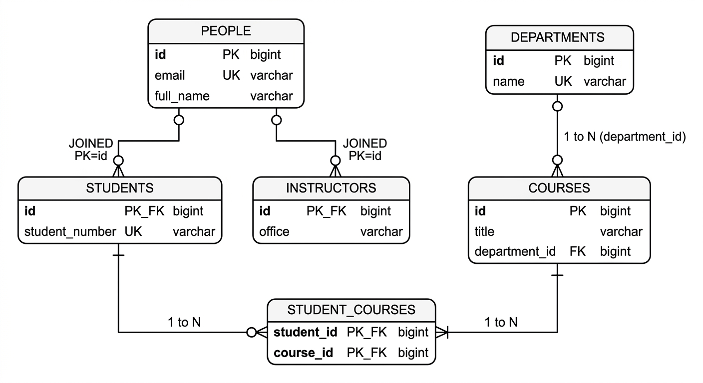

# Informe de Análisis del Demo Inicial: jpa-clean-persistence-demo
**Laboratorio de Ingeniería de Software II — Periodo 2-2026**  
**Taller 10: Java Persistence API - JPA**  
**Universidad del Cauca**
**Integrantes: Duvan Alexis Hoyos y Juan José Hurtado**

---

## 1. Actividad 1.1: Reconocimiento de la Arquitectura

### 1.1 Tabla 1: Elementos del Demo y sus Responsabilidades

| Elemento | Archivo o Clase | Responsabilidad |
|---|---|---|
| **Presentación** | `SchoolController` | Expone los puntos de entrada HTTP REST (`/api/departments`, `/api/courses`, `/api/students`, etc.). Se encarga de recibir las solicitudes del cliente, deserializar los cuerpos JSON (mediante DTOs/records), delegar la ejecución a la capa de aplicación (`SchoolService`) y serializar las respuestas HTTP. No contiene reglas de negocio ni lógica de persistencia. |
| **Aplicación** | `SchoolService` | Orquesta los casos de uso del sistema escolar (crear departamento, crear curso, registrar estudiante y matricular estudiante en curso). Coordina las transacciones (`@Transactional`) y delega la persistencia invocando exclusivamente las interfaces de repositorio del dominio (`StudentRepository`, `CourseRepository`, `DepartmentRepository`), manteniéndose agnóstico a la tecnología de base de datos. |
| **Dominio** | `Student`, `Course`, `Department`, `Person`, `Instructor` | Representan los conceptos, entidades y reglas de negocio del problema escolar en Java puro. Modelan el estado y comportamiento esencial de forma independiente de cualquier framework o tecnología de almacenamiento (no contienen anotaciones ni importaciones de `jakarta.persistence.*`). |
| **Contrato de Repositorio** | `StudentRepository` (e interfaces afines) | Define el contrato abstracto (interfaz pura de Java) de persistencia que el dominio y la aplicación necesitan (`save`, `findById`, `findAll`, `enrollInCourse`). Expresa operaciones orientadas a la colección de entidades del negocio sin acoplarse a JPA ni a SQL. |
| **Implementación Concreta** | `StudentRepositoryJpa` | Implementa el contrato del dominio `StudentRepository` utilizando Spring Data JPA (`SpringStudentDataRepository`, `SpringCourseDataRepository`). Traduce las entidades de dominio a registros JPA mediante `DomainMapper`, gestiona la asociación y transaccionalidad con la base de datos, y retorna entidades de dominio a la capa superior. |
| **Modelo JPA** | `StudentRecord` (y demás `*Record`) | Es la representación de persistencia mapeada para la base de datos relacional mediante JPA/Hibernate. Contiene las anotaciones tecnológicas (`@Entity`, `@Table`, `@Id`, `@GeneratedValue`, `@ManyToMany`, `@JoinTable`). Su estructura optimiza el almacenamiento, las claves foráneas y la integridad relacional. |
| **Conversión de Modelos** | `DomainMapper` | Actúa como traductor bidireccional (Mapper/Adapter) entre el modelo de dominio puro (`Student`, `Course`, `Department`) y las entidades JPA (`StudentRecord`, `CourseRecord`, `DepartmentRecord`). Es esencial para mantener el desacoplamiento estricto, aislando los cambios del esquema relacional del modelo de negocio. |

---

### 1.2 Preguntas de Reflexión Justificadas

#### 1. ¿Qué ocurriría si se agregara `@Entity` directamente a la clase de dominio `Student`?
* **Pérdida de independencia tecnológica (contaminación del dominio):** La clase de negocio quedaría acoplada a la especificación JPA (`jakarta.persistence.*`) y a un proveedor de persistencia (Hibernate).
* **Violación de principios de diseño:** Rompe el principio de responsabilidad única (SRP), ya que la clase `Student` tendría que responder por las reglas de negocio de un estudiante y simultáneamente por la forma en que se almacena en tablas relacionales.
* **Dificultad en pruebas unitarias:** Las pruebas unitarias de lógica pura requerirían lidiar con proxies de Hibernate, inicializaciones de colecciones perezosas (`LazyInitializationException`) y constructores sin argumentos forzados por JPA.
* **Rigidez ante cambios:** Si el mecanismo de almacenamiento cambia a una base de datos documental (MongoDB) o una API externa, el dominio tendría que ser reescrito.

#### 2. ¿Por qué `SchoolService` depende de `StudentRepository` y no directamente de `SpringStudentDataRepository`?
* **Inversión de Dependencias (DIP - SOLID):** Los módulos de alto nivel (la lógica de aplicación en `SchoolService`) no deben depender de módulos de bajo nivel (tecnología Spring Data JPA). Ambos deben depender de abstracciones (`StudentRepository`).
* **Sustituibilidad y bajo acoplamiento:** Permite cambiar la implementación de persistencia (por ejemplo, cambiar Spring Data JPA por JDBC puro, un mock en memoria para pruebas rápidas, o un cliente NoSQL) sin tocar una sola línea de código en `SchoolService`.
* **Protección del dominio:** Impide que los métodos específicos de `JpaRepository` (como `flush()`, `getOne()`, `saveAndFlush()`) se filtren a la lógica de aplicación.

#### 3. ¿Qué responsabilidades tiene `StudentRepositoryJpa` que no deberían estar en `Student`?
* **Gestión técnica de persistencia:** Coordinación con el contexto de persistencia de Hibernate (`EntityManager`/Spring Data) y persistencia física en disco.
* **Manejo de claves foráneas y relaciones relacionales:** Cargar el registro `CourseRecord` de la base de datos para asociarlo en la tabla intermedia mediante transacciones SQL.
* **Traducción entre modelos:** Invocar a `DomainMapper` para pasar de objetos de negocio a registros de persistencia y viceversa.
* **Manejo de transacciones técnicas:** Asegurar atomicidad (`@Transactional`) a nivel de base de datos relacional.

#### 4. ¿Qué ventajas y costos introduce tener una clase `Student` y otra `StudentRecord`?
* **Ventajas:**
  1. *Aislamiento total:* El modelo de dominio evoluciona según las necesidades del negocio sin verse limitado por restricciones relacionales.
  2. *Seguridad y estabilidad:* El dominio no expone getters/setters técnicos requeridos por Hibernate ni llaves foráneas crudas.
  3. *Flexibilidad de diseño:* Una entidad de dominio puede ser rica en métodos de negocio, invariantes y encapsulamiento estricto, mientras que el Record JPA se enfoca en rendimiento relacional y mapeo declarativo.
* **Costos (Trade-offs):**
  1. *Duplicación de clases y propiedades:* Hay que mantener dos clases con nombres de campos muy similares.
  2. *Sobrecarga de mapeo (Boilerplate):* Necesidad de escribir y mantener conversores explícitos (`DomainMapper`).
  3. *Coste de memoria/CPU leve:* Cada operación de lectura o escritura crea nuevos objetos en memoria para realizar la traducción.

#### 5. ¿Qué tendría que cambiar si se reemplazara H2 por PostgreSQL manteniendo el mismo contrato de repositorio?
* **Lo que NO cambia (100% intacto):**
  - La capa de presentación (`SchoolController`).
  - La capa de aplicación (`SchoolService`).
  - Todo el dominio (`Student`, `Course`, `Department`, `StudentRepository`, etc.).
* **Lo que SÍ cambiaría:**
  1. *Dependencias en `pom.xml`:* Reemplazar `com.h2database:h2` por el driver `org.postgresql:postgresql`.
  2. *Configuración en `application.properties`:*
     - `spring.datasource.url=jdbc:postgresql://localhost:5432/schooldb`
     - `spring.datasource.username=usuario_postgres`
     - `spring.datasource.password=clave`
     - `spring.jpa.properties.hibernate.dialect=org.hibernate.dialect.PostgreSQLDialect`
  3. *Generación de IDs en los Records JPA:* Si se usaba `IDENTITY` en H2, en PostgreSQL se puede mantener o migrar a `GenerationType.SEQUENCE` para mayor rendimiento en inserciones por lotes.
  4. *Nivel de repositorio JPA (`*RepositoryJpa`):* En general, el código Java de los adaptadores no cambia gracias al estándar JPA, a menos que existan consultas nativas dependientes del motor SQL.

---

## 2. Actividad 1.2: Comprender las Relaciones

### 2.1 Análisis de Anotaciones en `infrastructure.jpa.record`

#### ¿Cuál es el lado propietario de la relación entre `DepartmentRecord` y `CourseRecord`?
* El **lado propietario es `CourseRecord`**.
* **Justificación técnica:** `CourseRecord` contiene la anotación `@ManyToOne` y define `@JoinColumn(name = "department_id", nullable = false)`. En JPA, el lado propietario es aquel que mantiene y mapea físicamente la columna de clave foránea (`department_id`) en la tabla de la base de datos (`courses`).

#### ¿Por qué `mappedBy = "department"` aparece en la relación uno a muchos?
* En `DepartmentRecord`, la anotación `@OneToMany(mappedBy = "department", ...)` indica que esta entidad es el **lado inverso o no propietario** de la relación bidireccional.
* El atributo `mappedBy = "department"` le indica a JPA/Hibernate que la relación ya fue definida y mapeada por el atributo `department` dentro de la clase `CourseRecord`. Esto previene que Hibernate cree una tabla intermedia redundante para el `@OneToMany`.

#### ¿Qué función cumple `@JoinColumn` en la relación muchos a uno?
* Especifica el nombre explícito de la columna de clave foránea física en la tabla `courses` (`name = "department_id"`).
* Define restricciones de integridad relacional en DDL (`nullable = false`), asegurando que ningún curso pueda crearse sin estar asociado a un departamento existente.

#### ¿Qué tabla intermedia utiliza la relación muchos a muchos?
* Utiliza la tabla intermedia **`student_courses`**, configurada en `StudentRecord` mediante:
  ```java
  @JoinTable(name = "student_courses",
      joinColumns = @JoinColumn(name = "student_id"),
      inverseJoinColumns = @JoinColumn(name = "course_id"))
  ```
  Posee dos claves foráneas: `student_id` (que referencia a `people.id` / `students.id`) y `course_id` (que referencia a `courses.id`).

#### ¿Qué diferencia existe entre la colección de cursos de un departamento y la colección de cursos de un estudiante?
1. **Tipo de cardinalidad:**
   - La colección en `DepartmentRecord` es **1 a N** (`@OneToMany`): un curso pertenece de manera exclusiva a un único departamento.
   - La colección en `StudentRecord` es **N a M** (`@ManyToMany`): un curso puede tener múltiples estudiantes matriculados, y un estudiante puede estar matriculado en múltiples cursos.
2. **Ciclo de vida y pertenencia (Composición vs Agregación):**
   - La colección del departamento tiene `orphanRemoval = true` y `CascadeType.ALL`. Si se elimina un departamento, todos sus cursos son eliminados. Si un curso se saca de la lista del departamento, queda huérfano y se borra de la BD.
   - La colección del estudiante es una agregación no destructiva: si un estudiante cancela su matrícula o es eliminado, el curso **no** se elimina; únicamente se elimina el registro en la tabla intermedia `student_courses`.

---

### 2.2 Diagrama del Esquema Relacional del Demo

A continuación se presenta el esquema relacional resultante de la ejecución de JPA en H2:



* **Claves Primarias (PK):** `people.id`, `departments.id`, `courses.id`.
* **Claves Foráneas (FK):**
  - `students.id` $\rightarrow$ referencia a `people.id`.
  - `instructors.id` $\rightarrow$ referencia a `people.id`.
  - `courses.department_id` $\rightarrow$ referencia a `departments.id`.
* **Tabla Intermedia:** `student_courses` con clave primaria compuesta `(student_id, course_id)`.

---

## 3. Actividad 1.3: Comprender la Herencia

### 3.1 Análisis de `PersonRecord`, `StudentRecord` e `InstructorRecord`

#### 1. ¿Qué hace `@Inheritance(strategy = InheritanceType.JOINED)`?
Indica a JPA que la jerarquía de herencia se persistirá mediante el enfoque de **tablas unidas (Joined Table Strategy)**:
- Se genera una tabla para la clase raíz (`people`) con todas las columnas comunes.
- Se genera una tabla separada por cada subclase concreta (`students`, `instructors`) que contiene únicamente las columnas exclusivas del subtipo.
- La clave primaria de las tablas hijas es simultáneamente su clave primaria y una clave foránea que apunta a la clave primaria de la tabla padre `people`.
- Para reconstruir un objeto polimórfico, Hibernate realiza automáticamente un `JOIN` SQL entre la tabla padre y la tabla hija correspondiente.

#### 2. Atributos en la tabla base vs tablas especializadas:
- **Tabla Base (`people`):** Almacena `id`, `full_name` y `email`.
- **Tabla Especializada (`students`):** Almacena `id` (PK/FK) y `student_number`.
- **Tabla Especializada (`instructors`):** Almacena `id` (PK/FK) y `office`.

#### 3. Comparación entre clases de dominio y clases JPA de la jerarquía:
- **En el dominio (`Person`, `Student`, `Instructor`):** La herencia es puramente conceptual de POJO (Java puro). `Student` extiende de `Person` y agrega `studentNumber` y `courseIds`. No tiene dependencias de base de datos ni metadatos de almacenamiento.
- **En la persistencia (`PersonRecord`, `StudentRecord`, `InstructorRecord`):** La herencia está instrumentada con `@Inheritance`, `@Entity` y `@Table`. En esta capa, `StudentRecord` gestiona el `@ManyToMany` real hacia `CourseRecord`, mientras que en el dominio `Student` solo maneja una lista inmutable de identificadores `Long` (`courseIds`).

#### 4. ¿Qué cambiaría conceptualmente con `SINGLE_TABLE` o `TABLE_PER_CLASS`?
* **Si se usara `SINGLE_TABLE`:**
  - Todas las personas (estudiantes e instructores) se guardarían en una **única tabla** `people`.
  - Se agregaría una columna discriminadora (ej. `DTYPE varchar(31)`).
  - La tabla tendría columnas anulables (`student_number` nulo para instructores, `office` nulo para estudiantes), perdiendo la capacidad de definir restricciones `NOT NULL` a nivel de base de datos para los campos de subclase.
  - *Ventaja:* Mayor velocidad de consulta al evitar `JOINs`.
  - *Desventaja:* Esquema desnormalizado con valores `NULL`.
* **Si se usara `TABLE_PER_CLASS`:**
  - Se crearía una tabla completa por cada clase concreta (`students` y `instructors`).
  - No habría tabla `people`. Cada tabla hija duplicaría las columnas `full_name` y `email`.
  - *Ventaja:* No hay columnas nulas y cada tabla es autocontenida.
  - *Desventaja:* Las consultas polimórficas (ej. `SELECT * FROM Person`) requieren costosas operaciones de `UNION` SQL y complican la unicidad global de emails o IDs.

---

## 4. Actividad 1.4: Ejecución y Comprobación en H2

### 4.1 Verificación de Endpoints y Persistencia

Durante la ejecución en el entorno local (puerto 8080 con base de datos H2 en memoria `jdbc:h2:mem:schooldb`), se ejecutaron las operaciones requeridas con las siguientes respuestas HTTP verificadas:

#### Paso 1: Creación de Departamento
* **Endpoint:** `POST /api/departments`
* **Payload:** `{"name":"Computer Science"}`
* **Respuesta (200 OK):**
```json
{
  "id": 1,
  "name": "Computer Science"
}
```

#### Paso 2: Creación de Curso Asociado
* **Endpoint:** `POST /api/courses`
* **Payload:** `{"title":"Persistence with JPA", "departmentId": 1}`
* **Respuesta (200 OK):**
```json
{
  "id": 1,
  "title": "Persistence with JPA",
  "departmentId": 1
}
```

#### Paso 3: Registro de Estudiante
* **Endpoint:** `POST /api/students`
* **Payload:** `{"fullName":"Alex Morgan", "email":"alex@example.com", "studentNumber":"ST-1001"}`
* **Respuesta (200 OK):**
```json
{
  "id": 1,
  "fullName": "Alex Morgan",
  "email": "alex@example.com",
  "studentNumber": "ST-1001",
  "courseIds": []
}
```

#### Paso 4: Matrícula de Estudiante en el Curso
* **Endpoint:** `POST /api/students/1/courses/1`
* **Respuesta (200 OK):**
```json
{
  "id": 1,
  "fullName": "Alex Morgan",
  "email": "alex@example.com",
  "studentNumber": "ST-1001",
  "courseIds": [1]
}
```

#### Paso 5: Consultas en Consola H2
Al consultar las tablas mediante SQL en la consola H2 (`http://localhost:8080/h2-console`), se corroboran los registros persistidos:
1. `SELECT * FROM DEPARTMENTS;` $\rightarrow$ Retorna fila `(ID: 1, NAME: 'Computer Science')`.
2. `SELECT * FROM COURSES;` $\rightarrow$ Retorna fila `(ID: 1, TITLE: 'Persistence with JPA', DEPARTMENT_ID: 1)`.
3. `SELECT * FROM PEOPLE;` $\rightarrow$ Retorna fila `(ID: 1, EMAIL: 'alex@example.com', FULL_NAME: 'Alex Morgan')`.
4. `SELECT * FROM STUDENTS;` $\rightarrow$ Retorna fila `(ID: 1, STUDENT_NUMBER: 'ST-1001')`.
5. `SELECT * FROM STUDENT_COURSES;` $\rightarrow$ Retorna fila `(STUDENT_ID: 1, COURSE_ID: 1)`.

---

## 5. Conclusión de la Fase 1
El demo `jpa-clean-persistence-demo` implementa con éxito el patrón **Clean Persistence (Persistencia Limpia / Inversión de Dependencias en Repositorios)**:
1. El modelo de negocio se mantiene puro y testeable.
2. JPA y Spring Data quedan encapsulados como un detalle de infraestructura.
3. El mapeador `DomainMapper` asume la responsabilidad de traducir entre ambos mundos.

Este mismo patrón arquitectónico será la base estricta sobre la cual se diseñará e implementará el **Banco de Preguntas Saber Pro** en las siguientes fases.
